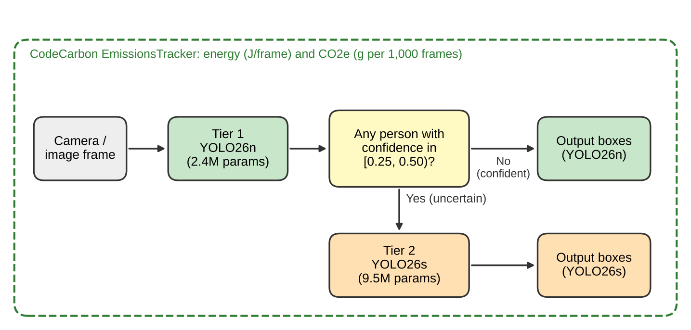
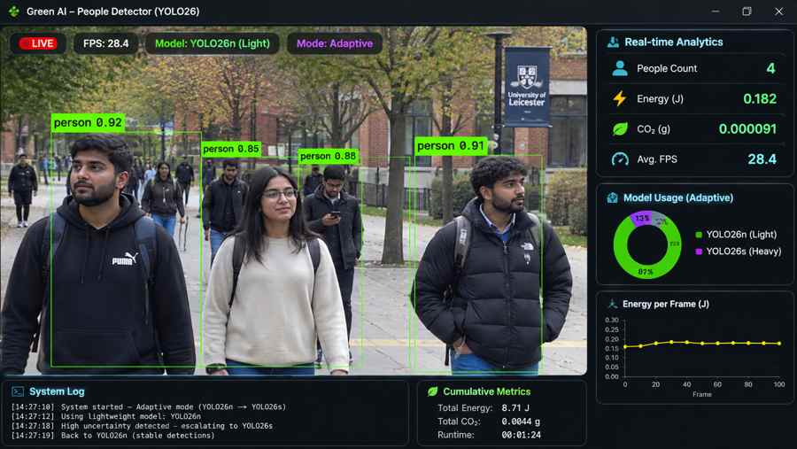
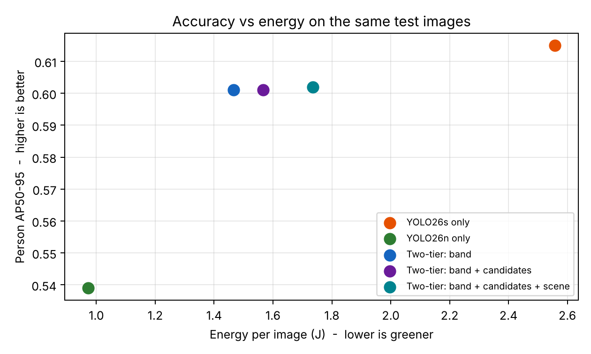

# Green AI People Detector

An energy-aware people-detection system built with **YOLO26** and **CodeCarbon**. It uses a lightweight-first, two-tier inference pipeline: YOLO26n processes every frame, while YOLO26s is called only when the lightweight model or scene checks indicate that a frame may need a closer look.

The project explores a practical Green AI question:

> Can adaptive model selection reduce inference energy while retaining useful person-detection performance?



## Demo preview



*Illustrative dashboard prototype. The FPS, people count, energy and CO₂ values visible in this image are sample values, not measurements from a validated live run.*

## Key features

- **Adaptive two-tier inference:** YOLO26n is the default model; YOLO26s handles selected escalated frames.
- **Confidence-based escalation:** uncertain detections and weak person candidates can trigger the larger model.
- **Optional scene checks:** dark or blurred frames can be escalated with `--scene`.
- **Periodic safety check:** video frames can be escalated at a configurable interval.
- **Energy tracking:** CodeCarbon records model-loading and inference energy separately.
- **Run logging:** summaries are printed and appended to `run_log.csv`.
- **Benchmarking:** compare model configurations on the same image set.

## How it works

1. A frame enters **Tier 1**, where YOLO26n (nano) performs the initial person detection.
2. The detector checks the confidence results and configured escalation conditions.
3. If a trigger fires, **Tier 2**, YOLO26s (small), re-processes that frame.
4. The system draws the detections and records timing, escalation and energy information.

### Escalation rules

| Trigger | Condition | Default |
|---|---|---|
| `uncertain` | Person confidence is between 0.25 and 0.50 | Enabled |
| `candidate` | Weak person candidate is between 0.10 and 0.25 | Enabled |
| `scene` | Frame is very dark (mean brightness below 40) or blurred (Laplacian variance below 30) | Disabled; enable with `--scene` |
| `periodic` | Every Nth frame is sent to the larger model as a safety check | Every 30 frames; disable with `--every 0` |

The confidence thresholds can be adjusted from the command line. Green boxes indicate detections handled by YOLO26n; orange boxes indicate an escalated frame, with the trigger reason shown on screen.

## Benchmark results

The table below records an exploratory run on **COCO128** (128 images, 254 person annotations) using a 2-vCPU CPU environment. The configurations use the same image set.

| Configuration | AP50* | AP50–95* | Recall | ms/image | J/image | Escalated |
|---|---:|---:|---:|---:|---:|---:|
| YOLO26s only (baseline) | 0.826 | 0.615 | 0.740 | 210.5 | 2.558 | – |
| YOLO26n only | 0.776 | 0.539 | 0.661 | 82.9 | 0.972 | – |
| Two-tier: confidence band only | 0.824 | 0.601 | 0.728 | 125.1 | 1.466 | 20.3% |
| **Two-tier: band + candidates (default)** | **0.822** | **0.601** | **0.740** | **133.6** | **1.566** | **25.0%** |
| Two-tier: band + candidates + scene | 0.822 | 0.602 | 0.740 | 147.9 | 1.735 | 27.3% |



`*` **Metric qualification:** these AP values are exploratory, lightweight person-class estimates produced by this repository's benchmark implementation. They are not official Ultralytics validation or pycocotools COCO metrics and should not be presented as formal COCO AP results.

### Initial observations

- In this run, the default adaptive configuration recorded the same recall as the YOLO26s-only baseline while using approximately 39% less estimated energy per image.
- Adding the candidate trigger increased recall compared with the confidence-band-only configuration, with a corresponding increase in energy.
- Scene checks increased energy in this particular test without improving the reported metrics. Their value needs to be assessed on a dataset containing more low-light and blurred scenes.
- The energy figures are estimates. On machines without hardware power counters, CodeCarbon may estimate CPU power using processor specifications; absolute joule values are therefore hardware- and environment-dependent.

These results are an initial comparison, not proof of generalisation. Use repeated runs, held-out video data and a formal evaluation implementation before making strong accuracy or energy claims.

## Requirements

- Python 3.9 or later recommended
- A webcam, video file or image folder for detection
- Internet access on first run to download the model weights and, for the default benchmark, the COCO128 dataset

Install the dependencies:

### Windows (PowerShell)

```powershell
python -m venv venv
venv\Scripts\Activate.ps1
python -m pip install --upgrade pip
pip install -r requirements.txt
```

### macOS / Linux

```bash
python3 -m venv venv
source venv/bin/activate
python -m pip install --upgrade pip
pip install -r requirements.txt
```

The YOLO26 weights (`yolo26n.pt` and `yolo26s.pt`) are downloaded automatically by Ultralytics when first required.

## Run the detector

Run the adaptive detector using the default webcam:

```bash
python green_detector.py
```

Other examples:

```bash
# Lightweight model only
python green_detector.py --mode nano

# Larger baseline model only
python green_detector.py --mode small

# Enable dark/blurred-scene escalation
python green_detector.py --scene

# Process a video and escalate every 15 frames
python green_detector.py --source video.mp4 --every 15

# Process an image folder without opening a display window
python green_detector.py --source images/ --no-show --save outputs/demo

# Run for a limited number of frames and save annotated output
python green_detector.py --max-frames 300 --save outputs/webcam-demo
```

Press **Q** to close a live display. Each run prints a summary and appends it to `run_log.csv`, including frame count, FPS, inference time, energy, CO₂e and escalation information.

## Reproduce the benchmark

Run the default COCO128 comparison:

```bash
python benchmark.py
```

Repeat the image set to obtain a longer measurement window:

```bash
python benchmark.py --repeats 5
```

Use a different Ultralytics dataset configuration:

```bash
python benchmark.py --data coco128.yaml --repeats 5
```

The benchmark writes:

- `benchmark_results.csv` — configuration-level benchmark results.
- `accuracy_vs_energy.png` — accuracy-versus-energy chart.

For a defensible experiment, keep the machine, software environment, dataset split and model versions fixed; perform multiple independent runs; and report variability. See the experimental protocol below.

## Suggested demonstration

1. Run `python green_detector.py --mode small` and show the baseline detections.
2. Run `python green_detector.py --mode nano` and compare the lightweight model.
3. Run `python green_detector.py` and show the adaptive escalation behaviour.
4. Try `--scene` with a darker or blurred scene, and explain why a frame is escalated.
5. Compare the generated `run_log.csv` entries and discuss energy per frame alongside detection quality.

## Repository structure

| Path | Description |
|---|---|
| `green_detector.py` | Adaptive two-tier detector and live demo |
| `benchmark.py` | Accuracy, speed and energy comparison |
| `requirements.txt` | Python dependencies |
| `accuracy_vs_energy.png` | Benchmark chart |
| `benchmark_results.csv` | Recorded benchmark table |
| `docs/EXPERIMENTAL_PROTOCOL.md` | Experimental design and reporting guidance |
| `docs/RESEARCH_GRADE_ROADMAP.md` | Future work toward a stronger evaluation |
| `docs/images/realtime_dashboard_sample.jpg` | Illustrative dashboard screenshot |
| `report/system_diagram.png` | System architecture diagram |
| `report/` | Coursework report materials |

## Limitations and future work

- COCO128 is a small evaluation set and does not represent all real-world surveillance or people-detection conditions.
- The benchmark's AP implementation is an exploratory approximation; formal reporting should use a validated evaluator such as Ultralytics validation and/or pycocotools.
- Energy estimates without hardware power counters should be interpreted cautiously and compared only under controlled conditions.
- Further evaluation should include crowded scenes, occlusion, low light, motion blur, small/distant people and independent video sequences.
- Future engineering work includes INT8 quantisation, ONNX/OpenVINO deployment, knowledge distillation, data-driven escalation thresholds and edge-device tests using a hardware power meter.

## Research integrity

Distinguish measured results from illustrative screenshots and estimates. Do not treat the dashboard preview as experimental evidence. Record the code commit, model weights, dataset version, hardware, software environment and command used for every reported experiment.
