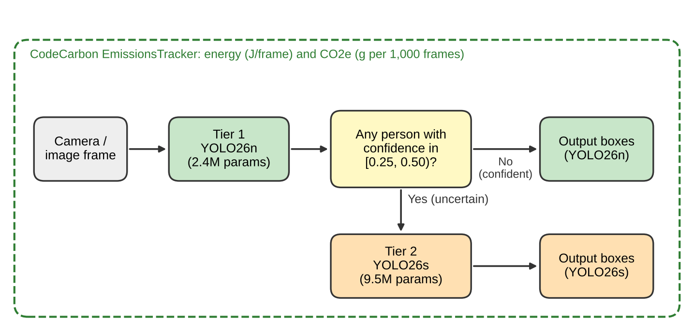
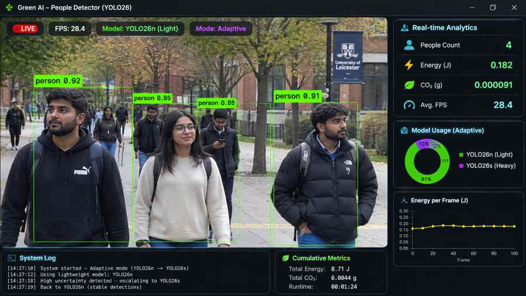

# Green AI People Detector

[](LICENSE)


An energy-aware people-detection pipeline built with **YOLO26** and **CodeCarbon**.

Most detection systems run one large model on every frame. This project runs a small model first and only calls a larger one when a frame actually needs it. YOLO26n processes every frame, and YOLO26s is invoked only when escalation rules (low confidence, weak candidates, dark or blurred scenes, or a periodic safety check) say a closer look is worthwhile. CodeCarbon tracks the estimated energy and CO₂e of each run, so you can see what accuracy you gain for the energy you spend.

The question the project explores:

> Can adaptive model selection reduce inference energy while keeping person detection useful on ordinary hardware?



## Demo preview



*Illustrative dashboard prototype. The FPS, people count, energy and CO₂ values shown are sample values, not measured results.*

## Features

- **Adaptive two-tier inference:** YOLO26n by default, with YOLO26s for escalated frames.
- **Confidence-based escalation:** uncertain detections and weak person candidates trigger the larger model.
- **Optional scene checks:** dark or blurred frames can be escalated with `--scene`.
- **Periodic safety check:** every Nth video frame can be re-checked by the larger model.
- **Energy tracking:** CodeCarbon records run-level energy and estimated emissions.
- **Run logging:** each run's summary is printed and appended to `run_log.csv`.
- **Benchmarking:** compare nano-only, small-only and adaptive configurations on the same labelled image set.

## How it works

1. A frame enters Tier 1, where YOLO26n performs person detection.
2. The detector checks confidence values and the configured escalation conditions.
3. If a trigger fires, Tier 2 (YOLO26s) re-processes that frame.
4. Detections are drawn and timing, escalation and energy information is recorded.

### Escalation rules

| Trigger | Condition | Default |
|---|---|---|
| `uncertain` | Person confidence between 0.25 and 0.50 | Enabled |
| `candidate` | Weak person candidate between 0.10 and 0.25 | Enabled |
| `scene` | Frame is very dark (mean brightness < 40) or blurred (Laplacian variance < 30) | Disabled; enable with `--scene` |
| `periodic` | Every Nth frame is sent to the larger model as a safety check | Every 30 frames; disable with `--every 0` |

All thresholds can be adjusted from the command line. Green boxes are detections from YOLO26n; orange boxes mark an escalated frame, with the trigger reason shown on screen.

## Installation

Requires Python 3.9 or later, plus a webcam, video file or image folder. Internet access is needed on first run to download model weights and the default COCO128 dataset.

**Windows (PowerShell)**

```powershell
python -m venv venv
venv\Scripts\Activate.ps1
python -m pip install --upgrade pip
pip install -r requirements.txt
```

**macOS / Linux**

```bash
python3 -m venv venv
source venv/bin/activate
pip install --upgrade pip
pip install -r requirements.txt
```

YOLO26 weights (`yolo26n.pt` and `yolo26s.pt`) are downloaded automatically by Ultralytics when first needed. The project has been developed and tested mainly on Windows; reports from other platforms are welcome.

## Usage

```bash
# Adaptive mode with the default webcam
python green_detector.py

# Lightweight model only
python green_detector.py --mode nano

# Larger baseline model only
python green_detector.py --mode small

# Enable dark/blurred-scene escalation
python green_detector.py --scene

# Process a video and escalate every 15 frames
python green_detector.py --source video.mp4 --every 15

# Process an image folder without a display window
python green_detector.py --source images/ --no-show --save outputs/demo

# Bounded webcam run
python green_detector.py --max-frames 300 --save outputs/webcam-run
```

Press **Q** to close a live display. Each run prints a summary and appends it to `run_log.csv`.

## Benchmarking

```bash
python benchmark.py --repeats 5
```

The benchmark writes:
- `benchmark_results.csv`: configuration-level results for the machine it ran on.
- `accuracy_vs_energy.png`: accuracy versus estimated energy chart.

For fair comparisons, use the same machine, dataset, image size, model weights and software environment for every configuration. Warm up the models, keep background load and power mode consistent, and report all runs rather than the best one. Don't mix results from different machines without labelling them. See [docs/EXPERIMENTAL_PROTOCOL.md](docs/EXPERIMENTAL_PROTOCOL.md) and [docs/LAPTOP_ONLY_EVALUATION.md](docs/LAPTOP_ONLY_EVALUATION.md) for the full protocol.

### Results status

The committed `benchmark_results.csv` holds an early 128-image exploratory run from a 2-vCPU CPU environment. Treat it as development data only. Validated results on laptop hardware are pending, so this README makes no claims yet about measured accuracy, FPS, latency, energy or CO₂e.

### About the measurements

- **Energy:** CodeCarbon gives estimates based on available hardware telemetry, not direct wall-power readings. When reporting, state the hardware, software versions, power mode and run conditions.
- **Accuracy:** the built-in AP calculation is a lightweight approximation. For formal results, use Ultralytics validation or pycocotools.

## Repository structure

| Path | Description |
|---|---|
| `green_detector.py` | Adaptive two-tier detector and live demo |
| `benchmark.py` | Accuracy, speed and estimated-energy comparison |
| `requirements.txt` | Python dependencies |
| `benchmark_results.csv` | Exploratory 2-vCPU results (development data only) |
| `docs/EXPERIMENTAL_PROTOCOL.md` | Experimental design and reporting guidance |
| `docs/LAPTOP_ONLY_EVALUATION.md` | Single-machine evaluation procedure |
| `docs/RESEARCH_GRADE_ROADMAP.md` | Planned future work |
| `docs/images/` | Illustrative images |
| `report/` | Project report and system diagram |

## Limitations

- COCO128 is a small evaluation set and doesn't cover all real-world conditions.
- Energy and CO₂e figures are estimates.
- Crowded scenes, occlusion, low light, motion blur and small or distant people need further evaluation.
- Edge-device deployment (e.g. Raspberry Pi, Jetson) is not yet implemented.

## Roadmap

- Package the detector as an installable Python library with a clean API
- Add tests and continuous integration
- Validate benchmarks across more hardware
- Add new escalation strategies and support for more model families

See [docs/RESEARCH_GRADE_ROADMAP.md](docs/RESEARCH_GRADE_ROADMAP.md) for details.

## Contributing

Contributions are welcome: bug reports, benchmark results from your own hardware, new escalation rules or documentation fixes. Please open an issue to discuss larger changes before sending a pull request. When sharing results, include your hardware, software versions and the exact command you ran.

## Research integrity

Keep implemented features, measured results, estimated values, illustrative material and future work clearly separate. Don't present a prototype image as a live screenshot. For every experiment, record the code commit, model weights, dataset version, hardware, software environment and command used.

## Origin

This project began as part of an MSc Artificial Intelligence module at the University of Leicester and is now maintained as an open-source project.

## License

Released under the [MIT License](LICENSE).
