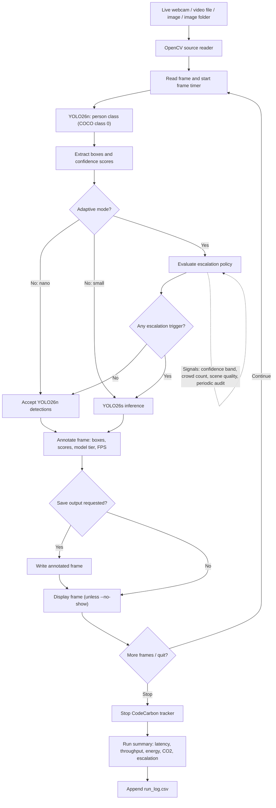

# Green AI People Detector — Real-Time Energy-Aware Adaptive YOLO26

A real-time people-detection research prototype that investigates the trade-off between **detection quality, inference latency, throughput, energy consumption and estimated carbon emissions**. It compares a lightweight YOLO26n detector, a larger YOLO26s detector and an explainable adaptive two-tier inference strategy.

> **Research status:** The repository currently implements webcam/video/image inference, adaptive model escalation, scene-quality heuristics, periodic audits, annotated output, run-level CodeCarbon measurement and a repeatable comparison script. It is a research prototype, not a certified safety or surveillance system. Read the implementation/limitations section before interpreting results.

## 1. Research objective

**Primary research question:** Can a lightweight-first adaptive inference policy reduce energy per processed frame while preserving an acceptable level of person-detection performance compared with always running a larger detector?

The system treats this as a multi-objective optimisation problem:

- Maximise person-detection quality.
- Minimise energy per frame and estimated CO2 per 1,000 frames.
- Minimise mean and tail latency.
- Maintain useful end-to-end throughput.
- Make escalation decisions observable and reproducible.

An energy reduction is only meaningful when reported alongside detection quality and uncertainty. A faster or lower-energy detector that misses substantially more people is not automatically a better system.

## 2. End-to-end architecture

The following flow describes the current implementation. GitHub renders this Mermaid diagram directly.



### System stages

| Stage | Current implementation | Output |
|---|---|---|
| Input | OpenCV webcam, video, image or image-folder reader | Frames |
| Pre-inference | YOLO preprocessing inside Ultralytics; OpenCV scene statistics for adaptive routing | Model-ready frame and optional scene signals |
| Tier 1 | YOLO26n, person class only | Bounding boxes and confidence scores |
| Routing | Confidence band, crowd threshold, brightness, contrast, blur heuristic and periodic audit | Keep nano result or escalate |
| Tier 2 | YOLO26s on escalated frames | Replacement detections for that frame |
| Presentation | OpenCV overlay | Person boxes, score, selected model, instantaneous detector FPS and escalation reason |
| Persistence | Optional annotated-frame output and run-level CSV | Images and metrics |
| Sustainability | CodeCarbon run-level tracker | Estimated energy and CO2 |

**Important routing behaviour:** when the larger model is invoked, its detections replace the nano detections for that frame. The current implementation does not merge the two model outputs or run non-maximum suppression across both models.

## 3. Adaptive inference: decision logic

YOLO26n is the default first-stage model. In adaptive mode, YOLO26s is invoked when one or more of these conditions is met:

1. **Uncertain detection:** at least one detected person's confidence lies in the configured interval `[LOW, HIGH)`.
2. **Crowded scene:** the number of nano detections reaches the configured crowd threshold (currently 5).
3. **Difficult visual conditions:** scene brightness is too low or too high, contrast is low, or Laplacian variance indicates blur/low detail.
4. **Periodic miss audit:** every Nth frame is escalated. This is a safeguard against confidence-only routing, which cannot identify a person that the first model completely fails to detect.

Default settings: confidence threshold 0.25, uncertainty band 0.25–0.50, image size 640 and audit interval 30 frames.

These thresholds are engineering heuristics, not learned or statistically calibrated decision boundaries. Scene statistics can be affected by camera exposure, background content and motion. An audit can recover some misses, but cannot guarantee that YOLO26s detects every missed person.

## 4. Real-time demonstration

### What you will see

- Live video with person bounding boxes.
- Confidence score beside each detection.
- Selected tier (YOLO26n or YOLO26s).
- People count for the current frame.
- Instantaneous detector-only FPS.
- Escalation reason when the adaptive policy invokes YOLO26s.

Press **Q** in the display window to stop. At shutdown, the terminal prints a run summary and appends it to `run_log.csv`.

The displayed FPS is calculated from the current detection call; it is **not** a guaranteed camera capture rate or full end-to-end latency measurement. The summary's wall-clock FPS is total processed frames divided by elapsed run time.

## 5. Installation

### Requirements

- Python 3.10 or newer is recommended.
- Windows, Linux or macOS.
- Webcam for the live demo, or a video/image source.
- Internet access on first run to download model weights.
- CPU works; a compatible NVIDIA GPU can accelerate inference.

### Windows PowerShell

```powershell
git clone https://github.com/Dinakarnayak/green-ai-people-detector.git
cd green-ai-people-detector

py -m venv .venv
.\.venv\Scripts\Activate.ps1

python -m pip install --upgrade pip
pip install -r requirements.txt
```

If PowerShell blocks activation, use Command Prompt:

```bat
.venv\Scripts\activate.bat
```

### Linux / macOS

```bash
git clone https://github.com/Dinakarnayak/green-ai-people-detector.git
cd green-ai-people-detector

python3 -m venv .venv
source .venv/bin/activate

python -m pip install --upgrade pip
pip install -r requirements.txt
```

For NVIDIA GPU acceleration, install a PyTorch build compatible with your CUDA driver using the official PyTorch installation selector, then install the remaining project requirements. Do not assume that installing this repository's requirements automatically provides a working CUDA setup.

## 6. How to run

### A. Real-time webcam — adaptive (recommended demo)

```bash
python green_detector.py --source 0 --mode adaptive
```

### B. Compare individual inference modes

```bash
# Lightweight detector only
python green_detector.py --source 0 --mode nano

# Larger detector only
python green_detector.py --source 0 --mode small

# Adaptive lightweight-first policy
python green_detector.py --source 0 --mode adaptive
```

Use the same camera, scene, resolution and duration when comparing modes.

### C. Run a video file

```bash
python green_detector.py --source sample.mp4 --mode adaptive
```

Save annotated frames:

```bash
python green_detector.py --source sample.mp4 --mode adaptive --save outputs/video
```

### D. Run on one image or an image folder

```bash
python green_detector.py --source sample.jpg --mode adaptive
python green_detector.py --source images/ --mode adaptive --save outputs/images
```

For unattended processing without an OpenCV display window:

```bash
python green_detector.py --source images/ --mode adaptive --no-show --save outputs/images
```

### E. Control the adaptive policy

```bash
# Confidence interval that triggers escalation
python green_detector.py --mode adaptive --band 0.25 0.60

# Audit every 15 frames; set 0 to disable periodic audits
python green_detector.py --mode adaptive --audit-every 15

# Disable scene-quality heuristics (confidence/crowd/audit remain)
python green_detector.py --mode adaptive --no-scene-aware

# Process a maximum of 300 frames
python green_detector.py --source 0 --mode adaptive --max-frames 300

# Change model input image size
python green_detector.py --source 0 --mode adaptive --imgsz 512
```

### F. First-run model downloads

Ultralytics downloads `yolo26n.pt` and/or `yolo26s.pt` when the selected mode first loads a model and the weights are not already available. The first run can therefore take longer than later runs. Keep the downloaded weights and record their versions/checksums for reproducible experiments.

## 7. Outputs and metrics

### Files generated locally

| File / folder | Purpose |
|---|---|
| `run_log.csv` | One row per detector run |
| `outputs/video/` | Annotated video-source frames when `--save` is used |
| `outputs/images/` | Annotated image frames when `--save` is used |
| `benchmark_results.csv` | Benchmark comparison output |
| `report/` | Architecture image and report draft |

### Run-level metrics

- `nano_frames`, `small_frames`: number of frames processed by each tier.
- `escalated_frames`, `escalation_rate_pct`: adaptive escalation frequency.
- `mean_detector_latency_ms`: mean time spent in the detector call(s) per frame.
- `wall_clock_fps`: processed frames divided by elapsed run time.
- `energy_kwh`, `energy_per_frame_j`: CodeCarbon run-level energy estimate and energy divided by processed frames.
- `co2_kg`, `co2_g_per_1000_frames`: estimated emissions and normalised emissions.

Energy per frame is an average allocation of run-level energy. It includes measurement and software overhead and is not a direct measurement of the marginal energy of one inference. Very short runs may be too short for stable energy sampling.

## 8. Reproducible benchmark

The benchmark evaluates YOLO26s-only, YOLO26n-only and adaptive inference on the same labelled validation images.

```bash
python benchmark.py --data coco128.yaml --repeats 5
```

Optional parameters:

```bash
python benchmark.py --data coco128.yaml --repeats 10 --conf 0.001 --band 0.25 0.50 --output results/repeated_run.csv
```

The script writes a CSV containing approximate person AP50/AP50-95, latency, wall-clock throughput, energy, emissions and escalation rate.

**Metric limitation:** the repository's custom AP implementation is a lightweight approximation. It is not an official COCO evaluation implementation. For a publication-quality result, use a fixed validation split and official Ultralytics validation and/or pycocotools; document the exact class mapping, IoU thresholds, confidence handling and evaluator version. The default `coco128.yaml` is a small demonstration dataset, not sufficient evidence for broad generalisation.

## 9. Research-grade experimental methodology

A stronger academic study should include the following:

1. **Dataset protocol:** define train/validation/test splits at the video or camera-session level to reduce near-duplicate frame leakage. Report dataset source, licensing, annotation policy, person-size distribution and scene conditions.
2. **Baselines:** compare YOLO26n-only, YOLO26s-only and adaptive inference under identical input, hardware and evaluation conditions. Add a fixed periodic escalation baseline and a random escalation baseline with a matched escalation budget.
3. **Ablation study:** disable one routing signal at a time (confidence, crowd, scene quality, periodic audit) and measure the effect on AP, energy, latency and escalation rate.
4. **Threshold sensitivity:** sweep confidence bands, audit interval, crowd threshold and scene thresholds. Select thresholds on validation data only; do not tune on the final test set.
5. **Repeated measurements:** perform multiple independent runs, warm up models, alternate model order where practical, control thermal/power conditions and report mean, standard deviation and confidence intervals.
6. **Quality and systems metrics:** report AP50 and AP50:95 from a standard evaluator, precision, recall, F1, false positives, false negatives, mean and p50/p95/p99 latency, end-to-end FPS, energy per frame and emissions per 1,000 frames.
7. **Robustness:** evaluate low light, overexposure, motion blur, occlusion, crowd density, small/distant people, camera movement and domain shift.
8. **Sustainability accounting:** state the CodeCarbon version, hardware telemetry availability, region/emissions factor, measurement duration and whether CPU, GPU and RAM energy were included. Avoid false precision.
9. **Statistical analysis:** use paired comparisons on the same sequences; report effect sizes and confidence intervals. Consider bootstrap confidence intervals over independent video sequences rather than treating adjacent frames as independent samples.
10. **Pareto analysis:** plot detection quality against energy and latency. Identify non-dominated operating points rather than claiming one universally best configuration.

See [docs/EXPERIMENTAL_PROTOCOL.md](docs/EXPERIMENTAL_PROTOCOL.md) and [docs/RESEARCH_GRADE_ROADMAP.md](docs/RESEARCH_GRADE_ROADMAP.md).

## 10. Current implementation vs advanced research extensions

| Capability | Status |
|---|---|
| Real-time webcam and video inference | Implemented |
| Person-only YOLO26n / YOLO26s inference | Implemented |
| Confidence, crowd, scene-statistics and periodic-audit escalation | Implemented |
| Annotated display and saved frame output | Implemented |
| Run-level CodeCarbon energy/emissions estimate | Implemented |
| Run summary CSV | Implemented |
| Repeated three-mode benchmark script | Implemented |
| Official COCO evaluation integration | Recommended extension |
| Persistent multi-object tracking (ByteTrack/BoT-SORT) | Not implemented |
| Learned/calibrated routing policy | Not implemented |
| Live web dashboard / database / alert service | Not implemented |
| Multi-camera orchestration and edge-device deployment | Not implemented |
| Formal uncertainty estimation and statistical significance pipeline | Research extensions |

## 11. Limitations and responsible use

- The current pipeline is sequential frame processing, not a multi-threaded production video system.
- It does not maintain person identities across frames; a person appearing in consecutive frames is detected independently each time.
- The current person count is a per-frame detection count, not a unique-person count.
- YOLO26s output replaces YOLO26n output on escalated frames; detections are not fused.
- Scene-quality thresholds are fixed heuristics and may not transfer between cameras.
- Periodic audits increase energy use and only provide opportunities to recover misses.
- CodeCarbon estimates are dependent on hardware telemetry and emissions factors.
- Detection performance may vary by environment and population. Test for uneven error rates and avoid consequential decisions based solely on automated detections.
- Follow applicable privacy, data-protection and consent requirements when recording or analysing people.

## 12. Suggested advanced research contributions

Potential extensions suitable for a deeper dissertation or PhD-level investigation include:

- **Calibrated selective inference:** train a routing policy using calibrated uncertainty, expected risk and a target energy budget.
- **Constrained optimisation:** minimise energy subject to explicit recall/precision or latency constraints; report the quality-energy Pareto frontier.
- **Temporal intelligence:** add tracking and temporal consistency so escalation can consider track instability, missed-track predictions and scene changes.
- **Adaptive compute control:** compare frame skipping, dynamic resolution, quantisation and model-tier selection under a fixed energy budget.
- **Domain adaptation:** test cross-camera and cross-location generalisation, then evaluate whether routing thresholds require recalibration.
- **Causal/ablation analysis:** isolate which routing signals cause measurable changes in energy and detection quality.
- **Edge deployment:** evaluate on a named edge device with measured power, thermal throttling, memory use and sustained throughput.

These are research directions, not claims about features currently present in this repository.

## 13. References

- Schwartz, R. et al. (2020). 'Green AI'. *Communications of the ACM*, 63(12), 54–63. https://doi.org/10.1145/3381831
- Lin, T.-Y. et al. (2014). 'Microsoft COCO: Common Objects in Context'. *ECCV 2014*. https://doi.org/10.1007/978-3-319-10602-1_48
- Ultralytics. YOLO26 documentation: https://docs.ultralytics.com/models/yolo26/
- CodeCarbon documentation: https://docs.codecarbon.io/
- PyTorch installation guide: https://pytorch.org/get-started/locally/

## 14. Academic integrity and reproducibility

Run the software and experiments yourself. Preserve raw outputs, configuration, hardware/software details and dataset versions. Replace report placeholders only with measurements you have reproduced. Do not present proposed extensions as implemented results, and do not describe the custom AP approximation as official COCO mAP.
